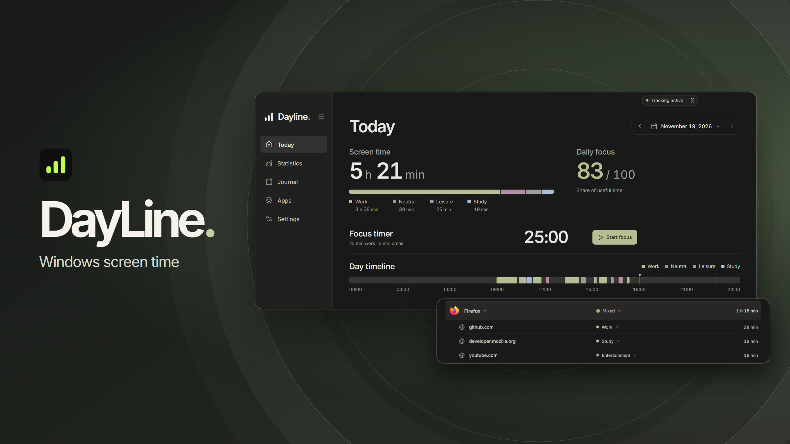
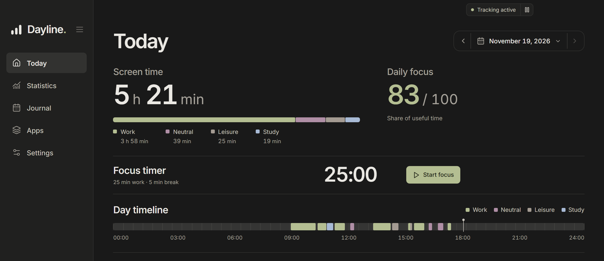
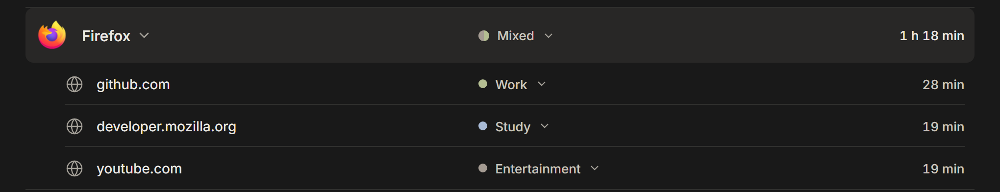
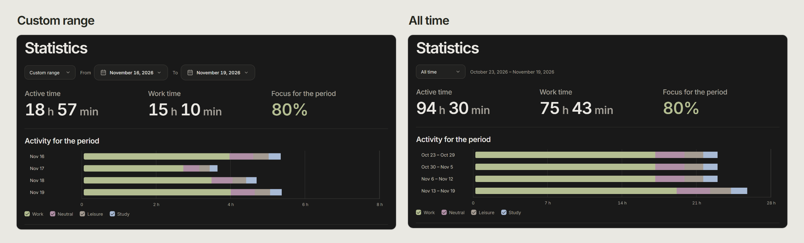
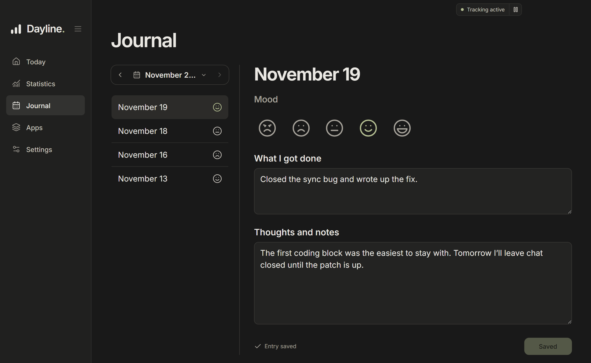
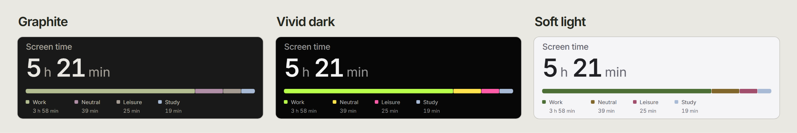

# DayLine

**See where your day went.** DayLine is a Windows app that tracks time in the active window and puts it beside a focus timer and a daily journal.

[Download DayLine for Windows x64](https://github.com/whitcore/DayLine/releases/latest) · [Changelog](CHANGELOG.md)



## What actually counted

Firefox might be open from breakfast to dinner. DayLine measures the time you spend in its foreground window while tracking is active. The daily timeline shows the stretches you spent coding, reading or chatting, with gaps for time away. Tracking pauses when Windows locks or reaches your chosen idle threshold. You can also pause from the system tray.



The screenshots use a demonstration profile.

## Website tracking in Chrome and Firefox

**Website tracking starts off.** To turn it on, open **Settings → Time tracking → Website tracking**. The switch covers Chrome and Firefox. After updating from a Firefox-only version, turn it on again to start collecting hostnames in both browsers.

Expand either browser in the app list to see time by hostname. In the Firefox example, GitHub took 28 minutes, the MDN docs took 19 and YouTube took another 19. Chrome reads its address bar through Windows accessibility on English and Russian browser interfaces. When DayLine cannot identify the address bar or recognizes a private window, it records the browser's app time.



Give a site its own category or let it inherit the browser’s category. Apps can use one category or split their time by percentage. The daily focus score can show a share of active time or progress toward a time goal you set.

Turn **Website tracking** off any time. New browser activity appears as app time. Existing hostname history stays in your local profile.

## See the shape of a week

Open Statistics to review seven days, pick your own date range or see all recorded time. Filter the chart by category to see when your study time landed, then open a day for its timeline. The app list below the chart shows how time broke down during the selected period.



## Make room for the next stretch

Start a work interval from Today. The focus timer defaults to 25 minutes of work and a five-minute break, with both durations adjustable. When the day winds down, use the journal to mark your mood, write down what you got done or leave yourself a note for tomorrow.



DayLine includes English and Russian, five themes and configurable motion. Graphite keeps the focus on the screen-time total, while the vivid and soft themes change the palette.



## Install and update

1. Download **Dayline-Setup-1.6.0.exe** from [GitHub Releases](https://github.com/whitcore/DayLine/releases/latest).
2. Run the installer on Windows 10 or 11 x64. It installs for the current user. The installer is unsigned and Windows SmartScreen may show a warning.
3. For an update, save a backup in Settings and exit DayLine from the tray before running the installer.

The installer includes the runtime. Recorded history starts with your first run.

## Privacy and local data

DayLine tracks the app in the foreground. Its local profile stores activity intervals, app names and executable paths for app icons, plus your categories, settings and journal entries. With website tracking enabled, the browser helper extracts the hostname from the visible address bar before returning it to the app. The history stores a hostname such as `developer.mozilla.org` alongside the interval. Full URLs, query strings, page titles and screenshots stay out of the history.

DayLine works locally without an account. The profile is in `%APPDATA%\Dayline`. In Settings, open **Data folder** to inspect it or **Save backup** to export it. The exported JSON can include browser hostnames, app paths and journal entries, so treat it as personal data.

## Source code and licensing

The desktop app, Windows helpers and installer configuration are public for inspection and local builds. The project has yet to adopt an open-source license, so default copyright applies to reuse and redistribution.

## Build and verify

On Windows x64 with Node.js 24 and npm:

```powershell
npm.cmd ci
npm.cmd start
npm.cmd test
npm.cmd run test:desktop
npm.cmd run package
```

The package command produces the NSIS installer in `release/1.6.0`. The desktop check launches Electron with a separate test profile. For implementation details, see the [architecture notes](docs/ARCHITECTURE.md).
